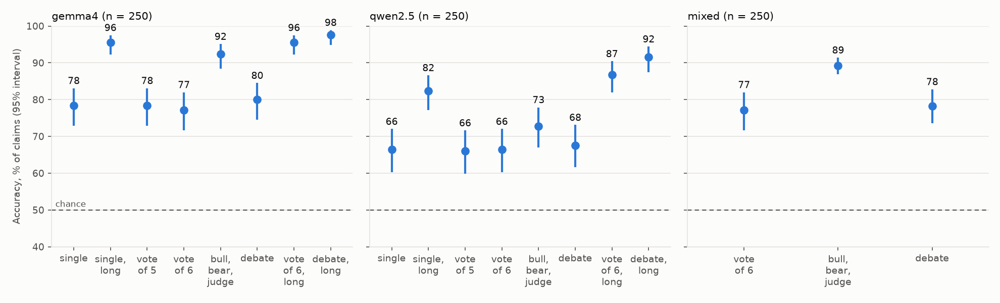

# Agon

**Three language models argue about a filing. Is that better than asking one model five times?**

On 250 true-or-false claims about fresh SEC filings, with two small local models, the answer was no. At the same budget of generated tokens, a two-round debate scored 1 to 3 points above a majority vote, and the 95% interval includes zero in two of the three set-ups. Voting did not beat a single answer either. The largest effect in the whole experiment was a prompt change I added afterwards: one model, asked once, allowed five lines of working where every other answer was held to two. It scored 96% and 82%, above every multi-agent system, on a third of the budget.



| | single | single, long | vote of 5 | vote of 6 | bull, bear, judge | debate | debate minus vote of 6 |
|---|---|---|---|---|---|---|---|
| gemma4 e4b | 78.4% | 95.6% | 78.4% | 77.2% | 92.4% | 80.0% | +2.8 points (0.4 to 5.2) |
| qwen2.5 7B | 66.4% | 82.4% | 66.0% | 66.4% | 72.8% | 67.6% | +1.2 points (-2.8 to 5.2) |
| both, mixed | | | | 77.2% | 89.2% | 78.2% | +1.0 points (-2.0 to 4.0) |

Brackets are paired bootstrap 95% intervals over the 250 questions. The three debate comparisons were fixed before the run. After a Holm correction across the three, the smallest p-value is 0.20. Chance is 50%. With the table hidden, the two models scored 50.0% and 49.6%, so they were not recalling the answers.

Read this with its limits in mind. These are 4-bit 7B-class models on a home GPU, the task is arithmetic on a small table, and "single, long" is a control I added after seeing the first results. The debate and the vote were only tested with two-line answers. Whether debate helps models that already have room to work was not measured.

## The question

Multi-agent debate is a popular design for AI trading systems. I could not find a head-to-head test of it against a single model on finance tasks at the same cost. General studies say debate does not reliably win. So: does it?

The design called for paid frontier models. This build spends nothing: every model runs locally through Ollama on one RTX 3080.

## Reproduce

```
uv sync
uv run python scripts/reproduce.py          # rebuild every table and figure from results/outcomes.csv
uv run python scripts/reproduce.py --fast   # also run the whole pipeline against a fake model
```

Neither command needs a GPU or the network. To run the models again:

```
ollama pull qwen2.5:7b-instruct
ollama pull gemma4:e4b-it-q4_K_M
uv run python scripts/fetch_data.py
uv run python scripts/reproduce.py --run-models
```

That took 3.0 hours of model time here and overwrites `results/`. The SEC adds filings to the source files over time, so a later download can draw a different set of 250. `results/questions.csv` lists the claims and filings this run used.

## What was built

- A question set: 250 true-or-false claims, one per filing, each about numbers in that filing's income statement and balance sheet for the quarter ended 30 September 2026. Half are true. The threshold in each claim sits 1%, 2% or 4% from the real value, so the model has to do the sum.
- Six systems, each run on each model:
  - `single`: one greedy answer.
  - `single, long`: one greedy answer with five lines of working allowed and twice the token cap. Added after the first results.
  - `vote of 5` and `vote of 6`: independent sampled answers and a majority vote.
  - `bull, bear, judge`: one agent told to argue the claim is true, one told to argue it is false, and a judge who reads both.
  - `debate`: three agents answer, read each other's answers, and answer again. Majority of the second round.
- A mixed set-up that puts both models in the same vote, debate or judge panel.
- A token ledger. The vote of 6, the judge panel and the debate each get 768 generated tokens per question, and a call that would break the budget raises an error.
- Accuracy, Brier score, calibration error and token counts for every system, with paired comparisons.

The debate's first round is the same three calls as the first three samples of the vote, with the same seeds. So debate against the vote of 6 compares two ways to spend the second half of the budget: let three agents read each other and answer again, or draw three more independent answers.

## What the run found

Numbers are from `results/summary.md` and `results/comparisons.md`.

**Debate against the vote.** The second round fixed more answers than it broke (16 against 9 for qwen, 7 against 2 for gemma, 34 against 10 across the two mixed line-ups). Three more independent votes did about as well. The gap is +1.0 to +2.8 points, and this sample can only resolve gaps of about 3 to 5 points.

**Voting did nothing.** The vote of 5 matched the single greedy answer to within half a point on both models. The vote of 6 gave the same verdict as the single answer on 230 of 250 questions for gemma and 224 for qwen. A model that gets a claim wrong mostly gets it wrong on every sample, and a vote cannot fix an error all the voters share.

**The judge panel looked like the winner, and mostly was not.** With gemma as judge the panel scored 92.4%, 15 points above the vote of 6. But the bull, the bear and the judge were each allowed five lines and 256 tokens, and every voter and debater was held to "one or two short lines". So I ran one more system: a single answer with the judge's allowance. It scored 95.6% for gemma and 82.4% for qwen. That is 3.2 points above the judge panel for gemma (interval -0.4 to 6.8) and 9.6 points above it for qwen (3.2 to 16.0). The long answers averaged about 100 tokens, under the 128-token cap the short answers already had. The cap was not what held the short answers back. The instruction to be brief was.

**Mixing models.** A mixed vote of 6 scored 77.2%, the same as gemma alone and 11 points above qwen alone. Mixed debate was 78.2%. Mixing did not lift debate above the vote.

**Calibration.** In their single answers both models said they were 95% to 100% sure almost every time, right or wrong. Brier scores follow accuracy: 0.044 for gemma's long answer, 0.052 for its judge panel, 0.18 for its vote and debate. See `results/fig_calibration.png`.

**Cost.** Per question, the vote of 6 generated 304 to 328 tokens, the debate 303 to 316, the judge panel 253 to 316, and the long single answer 92 to 110. The debate also read the most: about 4,300 prompt tokens per question against 3,800 for the vote and 630 for a single answer. See `results/fig_cost.png`.

## Sources

- Xiao, Sun, Luo and Wang, "TradingAgents: Multi-Agents LLM Financial Trading Framework", arXiv 2412.20138, 2024
- Smit et al., "Should we be going MAD? A Look at Multi-Agent Debate Strategies for LLMs", arXiv 2311.17371
- Zhang et al., "Stop Overvaluing Multi-Agent Debate", arXiv 2502.08788
- Du et al., "Improving Factuality and Reasoning in Language Models through Multiagent Debate", arXiv 2305.14325, for the debate procedure

In brief: the result agrees with Smit et al. and Zhang et al. that debate does not reliably beat simpler baselines. It does not reproduce Zhang et al.'s finding that mixing models helps debate. It says nothing about TradingAgents' trading results, which were not tested. `PAPER.md` has the protocol, the formulas, the full comparison and every variant tried.

## Data

Public company filings, through the SEC's XBRL frames API at `data.sec.gov`. It is free, needs no key or account, and the data is US government work. `scripts/fetch_data.py` downloads about 23 MB into `data/`, which git ignores. Nothing from the SEC is committed except the claims in `results/questions.csv`, which quote one company name and one threshold each.

Every filing is for the quarter ended 30 September 2026 and was filed in October or November 2026. The qwen model dates from 2024. I do not know gemma4's training cutoff, which is why the closed-book control is there.

Every prompt and response from the run is in `runs/`, which is also ignored. Only per-question outcomes are committed.

## How it is tested

50 tests, none of which need a GPU or model weights.

- The harness runs end to end against a fake model with known behaviour. A fake with 70% accuracy produces the vote accuracy the binomial formula predicts.
- Token budgets are enforced. A system that asks for more than its budget is stopped, and so is a backend that returns more tokens than its cap.
- Scoring is deterministic for a fixed set of responses. Building the report twice gives identical tables.
- The Wilson interval, Brier score, calibration error, McNemar test, sign-flip test and Holm correction are checked against closed forms and hand-worked values.
- Every generated claim is re-evaluated from the table by a separate function and must match its stored truth.

CI runs ruff, mypy, the tests and the fast reproduce on a CPU runner, then checks that the committed tables rebuild unchanged.

## Layout

```
src/agon/              the code
tests/                 maths tests first
scripts/reproduce.py   one command rebuilds every figure and table
scripts/fetch_data.py  downloads public data into data/ (never committed)
results/               committed figures and small tables
PAPER.md               citations, protocol, formulas, comparison with the sources
```

The model sits behind a one-method interface in `src/agon/backends.py`. Only the local backend and the fake are included. The local one refuses any host that is not this machine.

## Roadmap

- [x] Project skeleton, CI, and the reproduce command
- [x] An evaluation set of questions about public filings, each with an answer that can be checked in the filing itself
- [x] Four systems: one model; one model asked five times with a majority vote; a bull, a bear and a judge; a two-round debate
- [x] Every system held to the same token budget. The budget is on generated tokens. Prompt tokens are counted and reported but not capped.
- [x] Accuracy, calibration and cost for each
- [x] `PAPER.md` comparison with the sources
- [x] Results and limits written up at the top of this file
- [ ] Vote and debate with long answers. This is the experiment the control points to, and it was not run: the GPU budget was spent.
- [ ] Frontier models. Not run, because this build spends nothing.

## Limits

- The models are qwen2.5 7B and gemma4 e4b at 4-bit quantisation. The design imagined frontier models. A stronger model would likely get nearly all of these claims right alone, which leaves no room to measure anything. Nothing here says how debate behaves between frontier models.
- The brevity instruction dominates the result. Every voter and debater was told to show the calculation in one or two lines, and that cost 16 to 17 points against the five-line prompt. Debate and voting were never tested with five-line answers, so the comparison between them holds for terse agents only.
- The long single answer was added after I saw the first results. Its gain of 16 to 17 points is large and has an adjusted p-value below 0.001, but it is a post hoc finding from one prompt wording.
- One prompt wording per system, one seed, one run. One instruction moved accuracy by 16 points, so other wordings could move the rest.
- 250 questions, one per filing. Intervals on the paired differences are 2.4 to 4 points either side for debate against the vote. A real effect smaller than that would not show.
- The comparison table has 21 rows. Three were fixed in advance. Holm-adjusted p-values are given within each group, and the unadjusted ones should not be read alone.
- The task is arithmetic on a table of about 20 numbers. Questions with checkable answers are easier than real investment judgement. A win here would not show that debate picks better stocks, and a loss does not show that it picks worse ones.
- The bull and the bear are assigned a side on a claim that has a right answer. In the pilot log I saw a bull do the sum and concede that the claim was false. That is a weaker version of a bull and bear debate than the one in TradingAgents.
- The judge panel with gemma hit its token cap on 44 of 750 calls, and 8 rulings could not be read and were scored wrong. Its 92.4% would be a little higher with more room.
- The recall control shows the models cannot answer without the table. The thresholds are also my own, so the claims exist nowhere else. I could not check what gemma4 was trained on.
- Truth is computed from the tagged values shown to the model. I did not compare those with the printed filings. A tagging error would change what the claim is about, not whether it is scored correctly.
- The same seed gave the same output in a spot check. I did not run the full experiment twice to confirm that every response repeats.
- The control ran while the GPU was shared with other work and took 44 minutes for 500 calls. The timings in `results/run_info.md` are for this machine on this day.
- Results belong to the models tested on the date tested, 23 November 2026.
- This is research code. It is not investment advice and it does not trade.

## The name

Agon is the Greek word for a contest held in front of judges. It is where "protagonist" and "antagonist" come from.

## Licence

MIT. See `LICENSE`.
